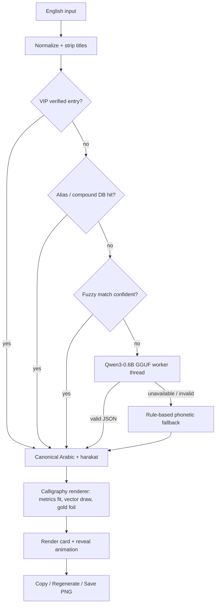

# Arabic Name Studio

> A desktop studio that turns any English name into authentic, museum‑grade Arabic calligraphy — fully offline.

<!-- TODO: add badges (build / license / release) once this repository has a public URL and CI. Do not add placeholder badges. -->

## Table of Contents

- [Overview](#overview)
- [Features](#features)
- [Screenshots / Demo](#screenshots--demo)
- [Tech Stack](#tech-stack)
- [Architecture](#architecture)
- [Getting Started](#getting-started)
- [Usage](#usage)
- [Configuration](#configuration)
- [Project Structure](#project-structure)
- [Roadmap](#roadmap)
- [Contributing](#contributing)
- [License](#license)
- [Acknowledgements](#acknowledgements)
- [Contact](#contact)
- [ملخص بالعربية](#ملخص-بالعربية)

## Overview

Arabic Name Studio is a PySide6 desktop application for Windows, macOS, and Linux. It resolves the *intended Arabic identity* of an English name — across spelling variants, compounds, and titles — then renders it as gold‑leaf Arabic calligraphy in one of six script styles. An optional on‑device Qwen3‑0.6B model handles ambiguous or unknown names; a curated name database and rule‑based engine keep the app fully functional without it.

## Features

Implemented and verified in the current codebase:

- **Name intelligence pipeline** — VIP verified entries → alias/compound database → fuzzy matching → optional AI reasoning → phonetic fallback. Verified names always override AI guesses.
- **Compound & variant recognition** — `Abdulhameed`, `Abdul Hameed`, `Abdelhamid`, and `Abdu-Hamid` all resolve to `عبد الحميد`; full names such as `Muhammad Ali` and `Abdul Rahman Ahmed` resolve word‑by‑word.
- **Asma‑ul‑Husna compounds** — `Abdul + attribute` structures generated for the 99 names across seven prefix spellings.
- **Harakat (vocalization)** — canonical diacritics applied by default (`مُحَمَّد`), with an internal on/off switch.
- **Optional on‑device AI** — Qwen3‑0.6B (GGUF, Q4_K_M) via `llama-cpp-python`, deterministic JSON decoding, background worker thread, graceful fallback when absent.
- **Six calligraphy styles** — Thuluth, Cocon Next Arabic, Naskh, Diwani, Ijazah, Maghrebi; each uses its original font file when installed, with distinct proportion/slant/weight parameters otherwise.
- **Museum‑grade rendering** — vector text drawn at a metrics‑solved size, optical centering, guaranteed containment, gold‑foil bevel and brushed texture, 1–2 s reveal animation.
- **Premium UI** — animated Islamic lattice with flowing golden veins, cinematic transformation overlay, spring‑physics buttons, vector icons, brand watermark layer.
- **Synthesized audio** — click, transformation soundscape, and completion chime generated in memory (no audio assets).
- **Export** — Save the rendered card as PNG; copy the Arabic text to clipboard.
- **Offline after setup** — no network calls at runtime; internet is used only to fetch fonts and (optionally) the model during installation.
- **Diagnostics** — `[AI]` terminal logs with per‑result provenance, file logging under `logs/`, and a headless verifier (`verify_ai.py`).

## Screenshots / Demo


<!-- TODO: add real captures under docs/screenshots/ and reference them relatively, e.g.

Suggested captures: landing page, transformation overlay, gallery with Thuluth, style switching, Save PNG dialog. -->

## Tech Stack

| Layer      | Technology |
|------------|------------|
| Language   | Python 3.10–3.12 recommended (3.13 supported for the UI; see AI note below) |
| GUI        | PySide6 (Qt for Python): QtWidgets, QtGui, QtCore, QtMultimedia |
| Rendering  | QPainter vector pipeline; Arabic shaping via Qt/HarfBuzz |
| AI (opt.)  | Qwen3‑0.6B GGUF (Q4_K_M) via llama‑cpp‑python (llama.cpp), CPU inference |
| Numerics   | NumPy (ink measurement / logo processing), Pillow |
| Arabic utils | arabic‑reshaper, python‑bidi (declared dependencies) |
| Fonts      | Amiri (bundled by setup); six style families auto‑detected if installed |
| Packaging  | None configured yet (see Roadmap) |

## Architecture



Key properties:

- The resolver runs on a background `QThread`; the UI never blocks on model load or inference.
- All results carry a provenance tag (`VIP`, `dictionary`, `cache`, `model`, `fallback`) exposed in logs.
- The renderer solves the point size from font metrics so the artwork fills the card's safe area without clipping.

## Getting Started

### Prerequisites

- Python 3.10–3.12 recommended. Python 3.13 runs the UI, but prebuilt `llama-cpp-python` CPU wheels are scarce for 3.13; `install_ai_engine.py` can create a Python 3.12 virtualenv automatically.
- `pip` available on `PATH`.
- ~200 MB disk for the app and dependencies; +~500 MB disk and ~1 GB RAM for the optional AI model.
- Internet access **only** for first‑time setup (fonts, optional model, pip packages).

### Installation

First‑time generator (creates `./ArabicNameStudio`, installs dependencies, downloads fonts):

```bash
python setup.py
cd ArabicNameStudio
python start.py
```

Existing checkout:

```bash
cd ArabicNameStudio
python -m pip install -r requirements.txt
python start.py
```

Optional AI engine (from the repository root):

```bash
python install_ai_engine.py
```

If a Python 3.12 virtualenv was created by the installer, launch through it:

```bash
cd ArabicNameStudio
start_ai.bat                      # Windows
# or: .venv-ai/Scripts/python.exe start.py
```

### Environment Variables

| Variable | Purpose | Example |
|----------|---------|---------|
| `ARABIC_STUDIO_AI_VERBOSE` | Enable (`1`, default) or silence (`0`) per‑inference `[AI]` terminal logs. Startup and model‑load messages always print. | `set ARABIC_STUDIO_AI_VERBOSE=0` |
| `ARABIC_STUDIO_MODEL` | Override the GGUF model path instead of scanning `ArabicNameStudio/ai/models/`. | `set ARABIC_STUDIO_MODEL=D:\models\Qwen3-0.6B-Q4_K_M.gguf` |

Linux/macOS equivalent:

```bash
export ARABIC_STUDIO_AI_VERBOSE=0
export ARABIC_STUDIO_MODEL=/opt/models/Qwen3-0.6B-Q4_K_M.gguf
```

### Running Locally

```bash
cd ArabicNameStudio
python start.py
```

### Building for Production

TODO: no packaging pipeline exists yet. Evaluate PyInstaller or Briefcase; ensure the `fonts/`, `assets/`, and `ai/models/` data directories are bundled and the Qt plugins are included.

### Running Tests

There is no automated unit‑test suite yet. The repository ships a headless pipeline verifier:

```bash
cd ArabicNameStudio
python verify_ai.py
```

It prints the database scale and resolves a fixed set of names (including VIP partials and spelling variants), reporting whether the AI tier or the fallback answered each one. TODO: add a pytest suite covering the resolver, vocalization, and renderer geometry.

## Usage

### UI usage

1. Launch `start.py`. The landing page accepts any English name or phrase.
2. Press **Generate** (or Enter). A cinematic transformation plays while the name is resolved.
3. The gallery shows the calligraphy on the render card. Use the style chips to switch scripts; the transition dissolves and re‑inks.
4. **Copy Text**, **Regenerate**, or **Save PNG** from the action bar. **Back** returns to the landing page.

### CLI usage

There is no server or REST API; the product is a desktop application. The only command‑line tool is the verifier:

```bash
python verify_ai.py        # headless pipeline check, exit code 0 on success
```

### Arabic / RTL notes

- **Text direction & shaping:** all Arabic output is laid out right‑to‑left using Qt's HarfBuzz shaping; ligatures and kerning come from the font, never from manual glyph manipulation.
- **Font support:** Amiri ships with the project. The six style families (Thuluth, Cocon Next Arabic, Naskh, Diwani, Ijazah, Maghrebi) are used from the OS when installed; otherwise each style falls back through a candidate chain to Amiri with style‑specific parameters.
- **Harakat:** vocalization is on by default and can be disabled programmatically via `Transliterator.set_harakat(False)`.
- **Transliteration vs. translation:** the resolver distinguishes personal names from general phrases; general phrases route to the AI tier for translation when the model is present.
- **Localization:** the UI strings are English‑only today. TODO: add an Arabic UI locale.

## Configuration

- **Model location:** any `*.gguf` under `ArabicNameStudio/ai/models/` (Q4_K_M preferred), or `ARABIC_STUDIO_MODEL`.
- **Brand logo:** place `assets/logo.png` to enable the watermark layer; a processed transparent cache is written to `assets/logo_processed.png`. Absent logo disables the layer gracefully.
- **Style library:** `rendering/styles.py` defines the six approved styles (font candidates, proportion, slant, weight, spacing, palette).
- **Logging:** `logs/app.log` (application) and `logs/ai_install.log` (engine provisioning).
- **Legacy:** `config/settings.py` contains early constants that are no longer consumed by the runtime. TODO: wire it up or remove it.

## Project Structure

```text
.
├── README.md
├── setup.py                  # One-time project generator (optional after setup)
├── install_ai_engine.py      # Optional AI engine provisioning (pip + GGUF download)
├── apply_*.py                # Historical maintenance patch scripts (not needed at runtime)
└── ArabicNameStudio/
    ├── start.py              # Application entry point
    ├── requirements.txt
    ├── verify_ai.py          # Headless pipeline verification
    ├── start_ai.bat          # Created by install_ai_engine.py when a venv is used
    ├── app/
    │   └── main.py           # Bootstrap, font loading, logging, exception hook
    ├── ai/
    │   ├── transliterator.py # Name DB, VIP entries, fuzzy + phonetic, vocalization
    │   ├── name_resolver.py  # 3-tier resolver, Qwen worker thread, caching
    │   └── models/           # Qwen3-0.6B GGUF (downloaded; optional)
    ├── rendering/
    │   ├── calligraphy.py    # Vector calligraphy renderer
    │   └── styles.py         # Six-style library
    ├── ui/
    │   ├── main_window.py    # Page orchestration, AI banner, brand overlay
    │   ├── home_page.py      # Landing page
    │   ├── calligraphy_page.py
    │   ├── glass_card.py     # Render card
    │   ├── style_selector.py
    │   ├── action_bar.py
    │   ├── transform_overlay.py
    │   ├── golden_veins.py   # Animated lattice veins
    │   ├── particles.py
    │   ├── brand.py          # Logo watermark layer
    │   ├── audio_manager.py  # Synthesized audio
    │   └── theme.py          # Design system
    ├── assets/               # logo.png (optional), logo_processed.png (cache)
    ├── fonts/                # Amiri + optional style fonts
    ├── config/               # settings.py (legacy constants)
    ├── logs/                 # app.log, ai_install.log
    └── cache/ exports/ docs/ # Reserved output directories
```

## Roadmap

- Per‑glyph vector‑outline engine for true interlocked (roundel) compositions.
- Larger curated name database via the built‑in `Transliterator.load_json()` importer.
- SVG and PDF vector export alongside PNG.
- Light theme and full Arabic UI localization.
- Batch and full‑name composition modes.
- Automated pytest suite and CI.
- Production packaging (PyInstaller/Briefcase).

## Contributing

Contributions are welcome.

1. Fork the repository and create a feature branch.
2. Keep changes idempotent and regression‑safe; the project has historically shipped as self‑verifying patch scripts — preserve that discipline (compile checks and import tests).
3. Run `python verify_ai.py` and launch the app before submitting.
4. Include logs from `logs/app.log` when reporting rendering or resolution bugs.
5. Open a pull request with a concise description of the root cause addressed, not just the symptom.

## License

License: MIT License.


## Acknowledgements

- The Qt Company and the PySide6 maintainers.
- The llama.cpp project and `llama-cpp-python` bindings.
- The Qwen team (Alibaba) for Qwen3‑0.6B.
- Khaled Hosny for the Amiri typeface; Google Fonts and Hugging Face mirror hosts for font and GGUF distribution.
- The `arabic-reshaper` and `python-bidi` projects.
- NumPy and Pillow contributors.

## Contact

TODO: add maintainer name, email, or repository issue tracker URL.

## ملخص بالعربية

<div dir="rtl">

«استوديو الأسماء العربية» تطبيق سطح مكتب يحوّل أي اسم إنجليزي إلى هويته العربية الصحيحة ثم يرسمه خطًّا ذهبيًّا بمتحفية راقية عبر ستة خطوط (الثُلث، النسخ، الديواني، الإجازة، المغربي، وكوكون_next). يعمل التطبيق دون اتصال بعد التثبيت، ويضم محرك ذكاء اختياريًا محليًا (Qwen3‑0.6B) لفك الغموض، مع قاعدة أسماء موثّقة وتشكيل صحيح للحركات.

</div>